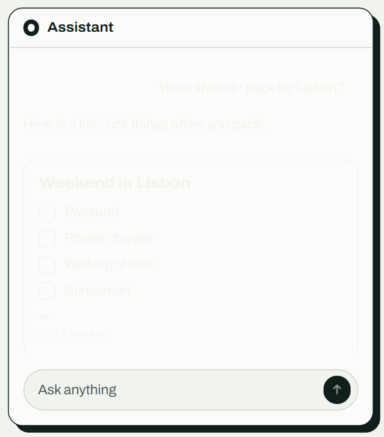

# ngx-mcp-apps

<p align="center">
  
</p>

> Unofficial community library. Not affiliated with or endorsed by Anthropic, OpenAI or the Model Context Protocol project.

An [MCP App](https://modelcontextprotocol.io/seps/1865-mcp-apps-interactive-user-interfaces-for-mcp) is a small web
page that an AI chat host, such as Claude, shows inside the conversation when the model calls a tool: a form, a chart,
an editor, instead of plain text. `ngx-mcp-apps` lets you write that page as a normal Angular application. It speaks
the MCP Apps protocol with the host for you and exposes everything as signals: the connection status, the data of the
tool call that opened the app, the host theme and the display mode. A second package, `ngx-mcp-apps-builder`, builds
the application into the single HTML file that hosts expect.

**Documentation, a live example and components to copy: [umb0o.github.io/ngx-mcp-apps](https://umb0o.github.io/ngx-mcp-apps/).**
Coding agents: start from [llms.txt](https://umb0o.github.io/ngx-mcp-apps/llms.txt).

- **Signals first.** Connection status, tool data, host theme and display mode are signals.
- **Lightweight, no dependencies.** The view side of the protocol is implemented here: about 13 KB minified, under 5 KB gzipped, with no runtime dependencies.
- **Checked at runtime.** Every message from the host goes through small hand-written type guards.
- **Tested against the official host.** The test suite connects the library to `AppBridge` from `@modelcontextprotocol/ext-apps`.

## Contents

- [Quick start](#quick-start)
- [How it fits together](#how-it-fits-together)
- [Following the model while the app is open](#following-the-model-while-the-app-is-open)
- [Checking your own data](#checking-your-own-data)
- [API](#api)
- [Configuration](#configuration)
- [Security](#security)
- [Compatibility](#compatibility)
- [Limits](#limits)
- [Packages in this repository](#packages-in-this-repository)

## Quick start

You need an Angular application (Angular 18 to 22, see [Compatibility](#compatibility)). A new one is fine:
`ng new my-app`.

### 1. Install

```bash
ng add ngx-mcp-apps-builder
```

This installs the builder and the library, and sets up the `build` target of your application to write one HTML
file (`dist/<project>.html`; choose another path with `--single-file`). Step 4 shows what it changes.

By hand instead:

```bash
npm install ngx-mcp-apps
npm install -D ngx-mcp-apps-builder
```

### 2. Configure

```ts
// app.config.ts
import { ApplicationConfig } from '@angular/core';
import { provideMcpApp } from 'ngx-mcp-apps';

export const appConfig: ApplicationConfig = {
  providers: [provideMcpApp({ name: 'my-app', version: '1.0.0' })],
};
```

### 3. Use `McpApp` in a component

```ts
// app.ts
import { Component, inject } from '@angular/core';
import { McpApp, isObject } from 'ngx-mcp-apps';

interface Greeting {
  message: string;
}
const isGreeting = (v: unknown): v is Greeting => isObject(v) && typeof v['message'] === 'string';

@Component({
  selector: 'app-root',
  template: `
    <p>{{ mcp.status() }} · {{ mcp.displayMode() }}</p>
    <p>{{ greeting()?.message }}</p>
    @if (mcp.canFullscreen()) {
      <button (click)="mcp.toggleFullscreen()">Fullscreen</button>
    }
  `,
})
export class App {
  protected readonly mcp = inject(McpApp);
  // structuredContent of the tool call that opened the app, checked and typed
  protected readonly greeting = this.mcp.structuredContentAs(isGreeting);
}
```

The connection starts on its own when `McpApp` is first injected. Outside a host (`ng serve`, a plain browser tab)
`status()` becomes `standalone`, so the same app can be developed as a normal page.

### 4. Build one HTML file

Hosts load the app from one HTML resource inside a sandboxed iframe, so the build must not need other files.
`ng add` has already done this. By hand: in `angular.json`, replace the builder of the `build` target and add the
`singleFile` option:

```json
{
  "projects": {
    "my-app": {
      "architect": {
        "build": {
          "builder": "ngx-mcp-apps-builder:application",
          "options": {
            "browser": "src/main.ts",
            "tsConfig": "tsconfig.app.json",
            "styles": ["src/styles.css"],
            "singleFile": "public/app.html"
          }
        }
      }
    }
  }
}
```

Keep the other options you already have: the builder runs Angular's official application builder with the same
options, then writes the single file.

```bash
ng build
```

```text
Single file: public/app.html (212.4 kB)
```

`public/app.html` is the whole app: every local script and stylesheet is inlined. This is the file your MCP server
returns to the host.

**No lazy loading.** One HTML file cannot fetch other chunks: use static imports only (no `loadComponent` /
`loadChildren`, no `@defer` blocks, no dynamic `import()`). If the build would need a separate chunk it fails with an
error that lists the files, instead of writing a file that breaks at runtime. Fonts and images referenced by your CSS
are embedded; an image named in a template (``) is not: use a `data:` URL or an absolute `https://` URL. More in the
[builder README](./projects/ngx-mcp-apps-builder/README.md).

Two more things to know inside the host iframe:

- if you need a router, use `withHashLocation()`: the iframe URL is not yours;
- `localStorage` may be unavailable in the sandbox: wrap it in `try/catch` and keep real state on your server.

## How it fits together

1. Your MCP server exposes a tool and, as the MCP Apps specification describes, serves the built HTML file as a
   `ui://` resource linked to that tool with `_meta.ui.resourceUri`.
2. When the model calls the tool, the host loads that HTML in a sandboxed iframe inside the conversation.
3. `McpApp` does the handshake with the host over `postMessage` and receives the tool arguments and the tool result:
   the `structuredContent` of that result is what `mcp.structuredContent()` returns.
4. From then on the app can call tools of your server, add context for the model and ask for another display mode.

The server side is out of scope of this project: any MCP server that follows the MCP Apps specification works, and how
you write it is up to you.

Hosts may cache the resource: put a hash of the build in the URI (`ui://my-app/app-<hash>.html`) so a new build is
always picked up.

## Following the model while the app is open

A tool result reaches the app once, when the app opens. To let the model keep writing into an app that is already open,
have it call a normal tool that stores the data on your server, and let the app follow that state:

```ts
// The model calls `write_note`; the app reads `read_note` every second
protected readonly note = this.mcp.pollServerTool('read_note', { intervalMs: 1000, guard: isNote });
```

Mark the reading tool as app-only on the server (`_meta: { ui: { visibility: ['app'] } }`) so the model does not see it.
`pollServerTool` must be called in an injection context (a field initializer or the constructor), or given `{ injector }`.

To talk back to the model:

```ts
await this.mcp.updateModelContext('The user is on exercise 3'); // silent, read on the model's next turn
const sent = await this.mcp.sendMessage('I am done'); // a chat message; false if the host refuses
```

Hosts may ask the user to confirm `sendMessage` or refuse it (common on mobile). Prefer `updateModelContext`
and let the user type in the chat.

## Checking your own data

Protocol messages are checked by the library. For the data your own server sends, pass a guard: any
`(value: unknown) => value is T` works (hand-written, generated by typia, a valibot `is`...). The type is inferred from it.

```ts
interface Note {
  id: number;
  text: string;
}
const isNote = (v: unknown): v is Note =>
  isObject(v) && typeof v['id'] === 'number' && typeof v['text'] === 'string';

note = this.mcp.pollServerTool('read_note', { guard: isNote }); // Signal<Note | undefined>
opened = this.mcp.structuredContentAs(isNote); // Signal<Note | undefined>
```

Invalid values are dropped and logged; the signal keeps the last valid one.

## API

### `McpApp` signals

| Signal                                                  | Meaning                                                                     |
| ------------------------------------------------------- | --------------------------------------------------------------------------- |
| `status`                                                | `connecting`, `connected` or `standalone`                                   |
| `connected`                                             | `true` once the handshake with the host succeeded                           |
| `toolInput`, `toolInputPartial`                         | Arguments of the tool call that opened the app (final, and while streaming) |
| `toolResult`, `structuredContent`                       | Result of that tool call                                                    |
| `toolCancelled`                                         | The host cancelled the tool call                                            |
| `hostContext`, `hostCapabilities`                       | What the host says about itself                                             |
| `theme`                                                 | `light` or `dark`, as reported by the host                                  |
| `displayMode`, `availableDisplayModes`, `canFullscreen` | `inline`, `fullscreen`, `pip`                                               |
| `events`                                                | Protocol log, newest first, when `log: true`                                |

### `McpApp` methods

| Method                                                        | Meaning                                                                    |
| ------------------------------------------------------------- | -------------------------------------------------------------------------- |
| `callServerTool(name, args)`                                  | Call a tool of your MCP server from the UI                                 |
| `pollServerTool(name, { intervalMs, args, guard, injector })` | Signal that follows a server tool                                          |
| `structuredContentAs(guard)`                                  | `structuredContent`, checked by your guard and typed                       |
| `updateModelContext(text, structuredContent?)`                | Add context for the model's next turn, without a chat message              |
| `sendMessage(text)`                                           | Post a user message; resolves `false` if the host refuses                  |
| `requestDisplayMode(mode)`, `toggleFullscreen()`              | Ask the host for another display mode; resolves with the mode actually set |
| `openLink(url)`                                               | Ask the host to open a link; resolves `false` if the host refuses          |
| `requestTeardown()`                                           | Ask the host to close the app                                              |
| `bridge`                                                      | The underlying `McpBridge`, for protocol methods not wrapped here          |

The methods that return a promise reject with an error when the app is not connected. `requestTeardown()` does
nothing in that case, and `bridge` is `undefined` when the app runs outside a host.

### Lower-level API

`McpBridge`, `parentWindowPort()`, the `Methods` constants and the guards are plain TypeScript and are exported too:

```ts
const bridge = new McpBridge(parentWindowPort(), { name: 'my-app', version: '1.0.0' });
bridge.onNotification(Methods.toolResult, (params) => {
  /* ... */
});
const { hostContext } = await bridge.connect();
```

## Configuration

Options of `provideMcpApp(config)`:

| Option            | Default       | Meaning                                                      |
| ----------------- | ------------- | ------------------------------------------------------------ |
| `name`, `version` | required      | Sent to the host during the handshake                        |
| `autoResize`      | `true`        | Tell the host the content size so the iframe fits it         |
| `connectTimeout`  | `4000`        | Ms to wait for the host before going `standalone`            |
| `requestTimeout`  | `60000`       | Ms to wait for an answer to a request                        |
| `log`             | `false`       | Keep the last 50 protocol events in `events` (for debugging) |
| `allowedOrigins`  | any           | Talk only to a parent window with one of these origins       |
| `port`            | parent window | Custom transport, mainly for tests                           |

## Security

What the library does:

- accepts messages only from the parent window, and ignores anything that is not JSON-RPC 2.0;
- checks the shape of every notification and result before exposing it; invalid data is dropped or raised as `McpError`;
- never evaluates code and never writes host data into the DOM (no `eval`, no `innerHTML`; host styles are not applied);
- bounds what it keeps: 50 log entries, each cut at 1000 characters, and a minimum polling interval of 100 ms;
- has no runtime dependencies.

What is up to you:

- **The host is trusted, the content is not.** Tool results come from your server and, through it, from the model:
  render them with Angular bindings (`{{ }}`), not with `[innerHTML]`.
- **Do not put secrets in the HTML.** Whoever can read the resource from your MCP server can read the whole app.
- **Outgoing messages go to any parent origin by default**, because hosts wrap the app in a
  sandbox whose origin you usually do not know. If you do know it, set `allowedOrigins`.
- **Protect your MCP server.** An unauthenticated server lets anyone with the URL call its tools.
- `log: true` stores host and server data in memory to show it: use it while debugging.

## Compatibility

Both packages support the same Angular versions.

| Package                | Angular            | Peer dependencies                                                                       |
| ---------------------- | ------------------ | --------------------------------------------------------------------------------------- |
| `ngx-mcp-apps`         | 18, 19, 20, 21, 22 | `@angular/core` `>=18.0.0 <23.0.0`                                                      |
| `ngx-mcp-apps-builder` | 18, 19, 20, 21, 22 | `@angular/build` `>=18.0.0 <23.0.0`, `@angular-devkit/architect` `>=0.1800.0 <0.2300.0` |

Each of these versions was checked with a new application that uses the library and is built by the builder, with
both the first release of the major (18.0.0, 19.0.0, ...) and its latest one: a production build, then the built page
opened in a browser.

- MCP Apps protocol `2026-01-26`. A different version announced by the host is logged, and the app keeps working.
- Automated tests run the library against the official `AppBridge`. It has been used in Claude through a custom connector.

## Limits

- Not wrapped yet: tools provided by the app to the host, sampling, file download, reading server resources.
  They are reachable through `bridge.request(...)` and `bridge.onRequest(...)`.
- Only the host context fields the library knows are validated; unknown fields are passed through as they are.
- The single HTML file cannot use lazy loading (see [Build one HTML file](#4-build-one-html-file)).

## Packages in this repository

| Package                                                   | What it is                                                   |
| --------------------------------------------------------- | ------------------------------------------------------------ |
| [`ngx-mcp-apps`](./projects/ngx-mcp-apps)                 | The runtime library: `McpApp`, `provideMcpApp`, `McpBridge`  |
| [`ngx-mcp-apps-builder`](./projects/ngx-mcp-apps-builder) | The Angular CLI builder that writes the app as one HTML file |

## Changelog

See [CHANGELOG.md](./CHANGELOG.md).

## Acknowledgements

This is an independent, unofficial implementation. It is inspired by, and owes its design to:

- [`@modelcontextprotocol/ext-apps`](https://github.com/modelcontextprotocol/ext-apps) (MIT / Apache-2.0), the official
  MCP Apps SDK: the handshake, the message flow and the auto-resize measurement are modelled on it, and its `AppBridge`
  is used in the test suite. No code from it is shipped in this package.
- The [MCP Apps specification (SEP-1865)](https://modelcontextprotocol.io/seps/1865-mcp-apps-interactive-user-interfaces-for-mcp).

"MCP", "Model Context Protocol", "Claude" and "ChatGPT" are names of their respective owners and are used only
to describe compatibility and credit. This project is not affiliated with or endorsed by any of them.

## License

MIT © 2026 umb0o
